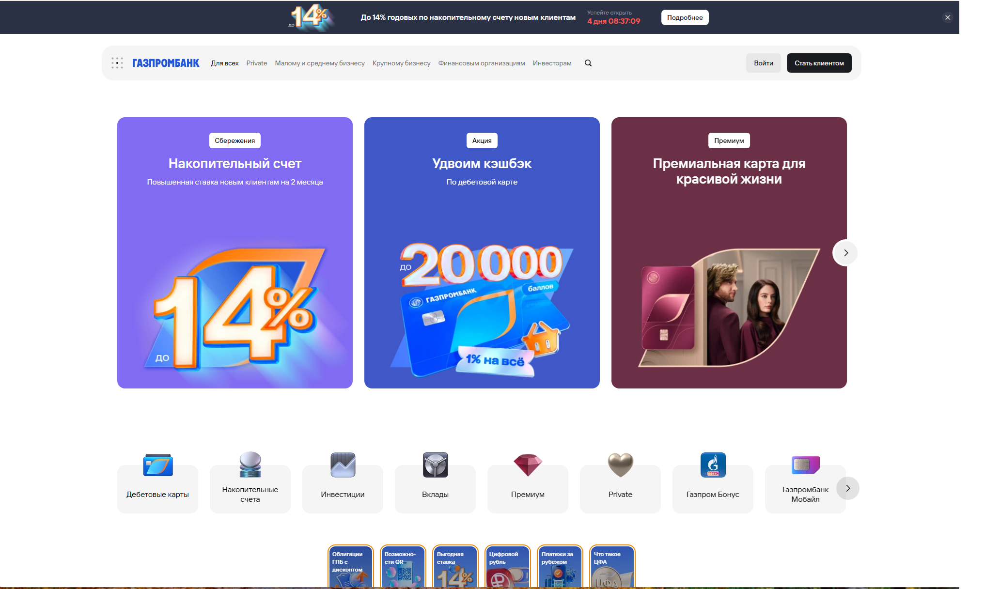
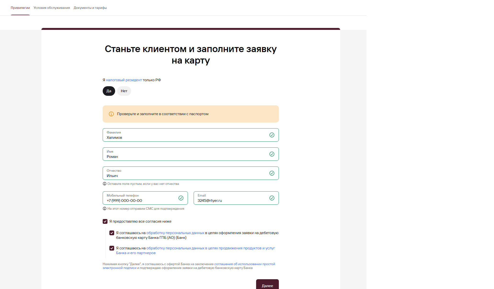

# Дипломный проект: Автоматизация тестирования веб-ресурсов и API (на примере Газпромбанка)

Данный проект представляет собой современный гибридный фреймворк для автоматизированного UI и API тестирования. В рамках работы реализовано сквозное UI-тестирование сценариев премиального обслуживания, сбор тарифных условий, верификация официальных документов, а также сквозное тестирование и валидация контрактов API-эндпоинтов подсказок (саггестов) формы оформления.

## 🛠️ Стек технологий

* **Язык программирования:** Python 3
* **Тестирование UI:** Selenium WebDriver (в связке с паттерном Page Object Model)
* **Тестирование API:** Requests (сессионное взаимодействие, обход систем защиты)
* **Фреймворк тестирования:** Pytest (параметризация, фикстуры, тегирование)
* **Валидация контрактов API:** JsonSchema (классическая проверка соответствия типов данных и обязательных полей)
* **Удаленная инфраструктура браузеров:** Selenoid (прогон UI-тестов в изолированных Docker-контейнерах)
* **CI/CD Оркестратор:** Jenkins (автоматизированный запуск параметризованных пайплайнов)
* **Отчетность и логирование:** Allure Report (интерактивные HTML-отчеты с логированием шагов, API-запросов/ответов, прикреплением скриншотов и видео)
* **Уведомления:** Отправка результатов тестирования в Telegram-bot

---

## 🏗️ Архитектура проекта

Проект построен по классической архитектуре **Page Object Model (POM)** и её расширения для бэкенда (**Application Object Model**), что скрывает техническую реализацию от логики самих тестов:

* `pages/` — описание веб-страниц, локаторов (XPath, CSS), базового API-клиента, а также бизнес-логики (клики, работа с API сессиями, закрытие анти-фрод окон).
* `pages/gpb_api_schemas.py` — изолированные классические JSON-схемы для строгой валидации структуры ответов сервера.
* `tests/` — тестовые сценарии `ui` и `api`.
* `utils/` — вспомогательные утилиты для прикрепления скриншотов, видеозаписей и консольных логов в отчеты Allure.
* `conftest.py` — конфигурация среды, параметризация кроссбраузерности и адаптивных разрешений экрана.
* `pytest.ini` — глобальные настройки фреймворка Pytest и регистрация маркеров запуска (`ui`, `api`).

---

## 📱 Покрытые сценарии (Тест-кейсы)

### 1. UI (Интерфейсные тесты)
* **`test_navigate_to_gpb_premium`** — Сквозной переход с главной страницы в раздел «Премиум» с автоматической фильтрацией и закрытием системных баннеров/cookie-окн.
* **`test_collect_premium_tariffs_directly`** — Проверка лимитов остатков на вкладке «Условия обслуживания» с динамическим сбором финансовых тарифов.
* **`test_check_privileges_tab`** — Тестирование вкладки «Привилегии» и сбор информации по бонусной программе «Газпром Бонус Премиум».
* **`test_check_documents_tab`** — Проверка вкладки «Документы и тарифы», валидация доступности официальных PDF-документов (на примере сборника тарифов программы «Аэрофлот Бонус»).

> **Адаптивность (Кросс-девайсность):** Каждый UI-тест параметризован и автоматически прогоняется как под десктопные дисплеи (1920x1080, 1440x900), так и под мобильные экраны (375x812, 440x956).

### 2. API (Тесты бэкенда)
* **`test_fio_predictions_pom`** — Параметризованный тест эндпоинта подсказок ФИО. Проверяет корректность автозаполнения полей Фамилии (`surname`), Имени (`name`) и Отчества (`second_name`). Включает автоматическую валидацию структуры JSON на соответствие контракту (типы данных, длина MD5-хэша `id`, соответствие значений `enum` для пола).
* **`test_email_predictions_pom`** — Тестирование эндпоинта подсказок доменов электронной почты с проверкой бизнес-логики: выдача пустых списков для коротких префиксов и генерация предсказаний при вводе полноценных адресов со знаком `@`.

---

## 📸 Визуализация интерфейсов и тестируемых зон

### Главная страница Газпромбанка и точка входа в Премиум
  
*Здесь автоматизация обрабатывает куки-баннеры и кликает по плитке «Премиум».*

### Раздел Премиум: Форма оформления и работа API подсказок (саггестов)
  
*При заполнении полей ФИО и Email бэкенд обрабатывает запросы на предсказание ввода, возвращая структурированные MD5-хэшированные данные, покрытые нашими API-тестами.*

---

## 🚀 Как запустить проект

### 1. Локальный запуск (в PyCharm / Терминале)

1. Склонируйте репозиторий:
   ```bash
   git clone https://github.com
   ```
2. Создайте и активируйте виртуальное окружение, затем установите зависимости:
   ```bash
   python3 -m venv .venv
   source .venv/bin/activate  # Для Windows: .venv\Scripts\activate
   pip install -r requirements.txt
   ```

3. **Гибкий запуск тестов по маркерам:**
   * Запустить **только быстрые API тесты** (пройдут за секунды без открытия браузера):
     ```bash
     pytest -m api --alluredir=allure-results --clean-alluredir
     ```
   * Запустить **только UI тесты** (в изолированном или headless режиме):
     ```bash
     pytest -m ui --headless --alluredir=allure-results --clean-alluredir
     ```
   * Запустить **абсолютно все тесты** в проекте:
     ```bash
     pytest --alluredir=allure-results --clean-alluredir
     ```

4. Посмотреть интерактивный Allure-отчет:
   ```bash
   allure serve allure-results
   ```

### 2. Запуск в CI/CD (Jenkins)

Проект полностью интегрирован с удаленным сервером Jenkins (через веб-конфигурацию Freestyle Project / Pipeline). 

* Поддерживает **параметризованный запуск** через переменную `${MARKER}`, позволяя одной кнопкой выбирать запуск `api`, `ui` или `all`.
* Передает инструкции для выполнения графических тестов на удаленный кластер **Selenoid**.
* Автоматически очищает результаты прошлых сборок с помощью ключа `--clean-alluredir`.
* Генерирует интерактивные отчеты **Allure Report**, прикрепляя скриншоты падений, логи браузера и видеозаписи сессий, после чего отправляет уведомление в Telegram.